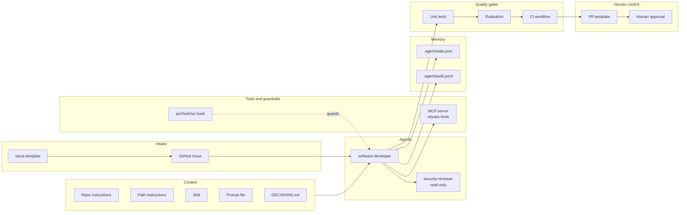
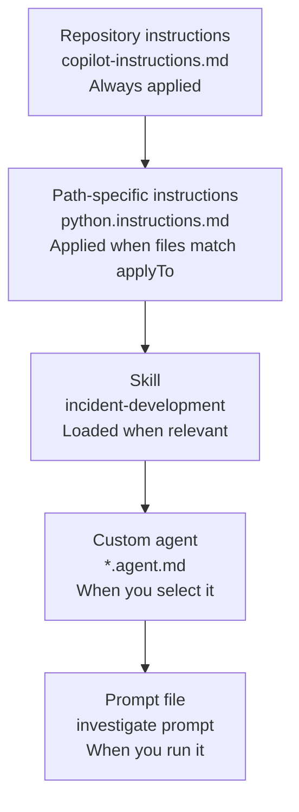
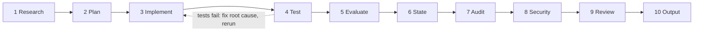
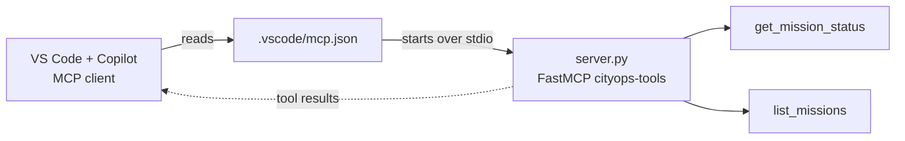
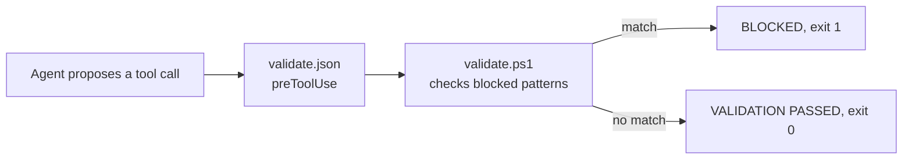
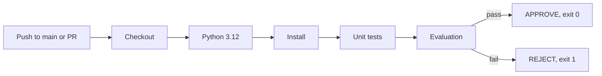
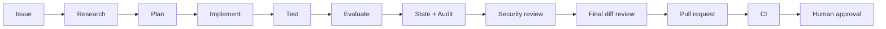

# GH-600 CityOps Agentic Workflow: Student Lab Guide

Self-paced exercises for this repository. Work through each lab in order and record your observations in the blank tables. You can copy this file into your fork and fill in the answers there.

| Your details | |
|---|---|
| Name | |
| Date | |
| Your fork URL | |
| Trainer | |

## Contents

- [How to use this guide](#how-to-use-this-guide)
- [Before you start](#before-you-start)
- [Lab 1: Explore the repository](#lab-1-explore-the-repository)
- [Lab 2: Run the CityOps application](#lab-2-run-the-cityops-application)
- [Lab 3: Issues and the issue template](#lab-3-issues-and-the-issue-template)
- [Lab 4: Repository and path-specific instructions](#lab-4-repository-and-path-specific-instructions)
- [Lab 5: Skills and prompt files](#lab-5-skills-and-prompt-files)
- [Lab 6: Custom agents](#lab-6-custom-agents)
- [Lab 7: Model Context Protocol](#lab-7-model-context-protocol)
- [Lab 8: Hooks as guardrails](#lab-8-hooks-as-guardrails)
- [Lab 9: State and audit trail](#lab-9-state-and-audit-trail)
- [Lab 10: Tests, evaluation and CI](#lab-10-tests-evaluation-and-ci)
- [Lab 11: Decisions, pull requests and human approval](#lab-11-decisions-pull-requests-and-human-approval)
- [Capstone: from issue to approved pull request](#capstone-from-issue-to-approved-pull-request)
- [Reflection](#reflection)
- [Troubleshooting](#troubleshooting)
- [Notes](#notes)

---

## How to use this guide

This guide walks you through CityOps, a small Flask service that demonstrates how an AI agent can be briefed, constrained, observed and reviewed inside a normal GitHub workflow. Each lab has a short explanation, steps to perform, and blank tables or questions to complete. No answers are printed here: observe the behaviour yourself and write down what you saw.

Work through the labs in order, because later labs build on earlier ones. If you get stuck, check [Troubleshooting](#troubleshooting) before asking your trainer.



---

## Before you start

You need:

- A GitHub account with GitHub Copilot access
- VS Code with the GitHub Copilot and Copilot Chat extensions, signed in
- Git
- Python 3.12
- PowerShell (Windows users, for Lab 8)

Setup steps:

1. Fork this repository to your own GitHub account and enable **Actions** on your fork.
2. Clone your fork and open the folder in VS Code.
3. Create a virtual environment:
   ```
   python -m venv .venv
   ```
4. Activate it:
   - Windows: `.\.venv\Scripts\Activate.ps1`
   - macOS or Linux: `source .venv/bin/activate`
5. Install dependencies:
   ```
   pip install -r requirements.txt
   ```

| Setup check | Done (Y/N) | Notes |
|---|---|---|
| Repository forked and Actions enabled | | |
| Cloned and opened in VS Code | | |
| Virtual environment active | | |
| Requirements installed without errors | | |
| Copilot Chat signed in and responding | | |

---

## Lab 1: Explore the repository

Before running anything, find each file and describe in your own words what it is for. This builds the mental map you will use for the rest of the day.

| File | Which concept does it demonstrate? | What does it do? |
|---|---|---|
| `app.py` | | |
| `test_app.py` | | |
| `eval/evaluate.py` | | |
| `DECISIONS.md` | | |
| `.github/copilot-instructions.md` | | |
| `.github/instructions/python.instructions.md` | | |
| `.github/skills/incident-development/` | | |
| `.github/prompts/investigate.prompts.md` | | |
| `.github/agents/software-development.agent.md` | | |
| `.github/agents/security-reviewer.agent.md` | | |
| `.github/mcp/server.py` | | |
| `.vscode/mcp.json` | | |
| `.github/hooks/validate.json` and `validate.ps1` | | |
| `.github/workflows/ci.yml` | | |
| `.github/ISSUE_TEMPLATE/incident.yml` | | |
| `.github/pull_request_template.md` | | |
| `.agent/state.json` | | |
| `.agent/audit.jsonl` | | |

---

## Lab 2: Run the CityOps application

Start the app:

```
python app.py
```

It listens on port 5000. Open each endpoint in your browser and record what you see.

| Endpoint | HTTP status | What was returned |
|---|---|---|
| `http://localhost:5000/` | | |
| `/incidents` | | |
| `/incidents/1` | | |
| `/incidents/999` | | |
| `/incidents/1/priority` | | |
| `/incidents/2/priority` | | |
| `/incidents/999/priority` | | |
| `/agent/state` | | |
| `/agent/audit` | | |

| Question | Your answer |
|---|---|
| Which of your requests appear in `/agent/audit`, and what event name was used for each? | |
| Which endpoint does not write an audit record when you call it? | |

---

## Lab 3: Issues and the issue template

On your fork, select **New issue** and choose **CityOps Incident Change**. Notice which fields are required.

| Field on the form | Required? | Why would an agent need this? |
|---|---|---|
| Objective | | |
| Requirements | | |
| Acceptance Criteria | | |
| Risk | | |

Now create an issue you will use in the capstone:

- **Title:** `[Incident]: Map low severity incidents to P3`
- **Objective:** Support low severity incidents.
- **Requirements:** Low severity maps to P3 on the priority endpoint.
- **Acceptance Criteria:** Existing behaviour unchanged; tests, evaluation and CI pass.
- **Risk:** Low

| Item | Your answer |
|---|---|
| Issue number created | |
| What field would you add so an agent knows what it must **not** change? | |

---

## Lab 4: Repository and path-specific instructions

Open `.github/copilot-instructions.md` and `.github/instructions/python.instructions.md` and read both.



1. In Copilot Chat, ask: *"What is the definition of done in this repository?"* Check the **references** list in the response.
2. Open `app.py` and ask Copilot to add a small helper function (do not keep the change). Check the references list again.
3. Open `README.md` and ask a documentation question. Check the references list a third time.

| Test | Was `copilot-instructions.md` used? | Was `python.instructions.md` used? |
|---|---|---|
| Definition of done question | | |
| Helper function in `app.py` | | |
| README question | | |

| Question | Your answer |
|---|---|
| What does `applyTo: "**/*.py"` control? | |
| Name two things the repository instructions say to never do. | |
| Why does naming "remove tests to make CI pass" matter for an agent? | |

---

## Lab 5: Skills and prompt files

Open the `incident-development` skill and the `investigate` prompt.

| Question | Your answer |
|---|---|
| Which four fields make up the incident model? | |
| Which severities and statuses are supported today? | |
| What are the three minimum test cases the skill requires? | |
| Which test in `test_app.py` matches each of those three cases? | |
| Which agent does the investigate prompt bind to? | |
| What are the two possible decisions at the end of the prompt? | |

Run the investigate prompt from the Copilot Chat slash menu with the issue you created in Lab 3. Record the agent's output.

| Section | Summary of what the agent said |
|---|---|
| Understanding | |
| Relevant Files | |
| Proposed Change | |
| Test Plan | |
| Risks | |
| Decision | |

| Question | Your answer |
|---|---|
| Did the agent change any files? Why does that matter? | |

---

## Lab 6: Custom agents

Open the agents dropdown in Copilot Chat and find both custom agents. Compare their configuration.

| Item | software-developer | security-reviewer |
|---|---|---|
| Tools allowed | | |
| Can it edit files? | | |
| Can it run commands? | | |
| What it must return at the end | | |



Fill in what happens and the checkpoint for each phase of the developer agent.

| Phase | What happens | Checkpoint or rule |
|---|---|---|
| 1 Research | | |
| 2 Plan | | |
| 3 Implement | | |
| 4 Test | | |
| 5 Evaluate | | |
| 6 State | | |
| 7 Audit | | |
| 8 Security | | |
| 9 Review | | |
| 10 Output | | |

Try it: select **security-reviewer** and ask it to fix a line in `app.py`.

| Question | Your answer |
|---|---|
| What happened, and why is that the right design? | |

---

## Lab 7: Model Context Protocol

Open `.vscode/mcp.json` and select **Start** above the `cityops-tools` server. Switch Copilot Chat to **Agent** mode and open the tools picker.



| Check | Your observation |
|---|---|
| Transport type in `mcp.json` | |
| Command and arguments used to start the server | |
| Tools listed for `cityops-tools` | |
| Answer to "Which CityOps missions exist?" | |
| Answer to "What is the status of DEV-001?" | |
| Answer for an unknown mission such as XYZ-999 | |

| Question | Your answer |
|---|---|
| The MCP server reports one status for DEV-001 and `.agent/state.json` reports another. Which should be the source of truth, and how would you keep them in sync? | |

---

## Lab 8: Hooks as guardrails

Read `.github/hooks/validate.json` and `validate.ps1`. In PowerShell, pipe test strings into the script and record the result. For example:

```powershell
"git push --force" | powershell -ExecutionPolicy Bypass -File .github/hooks/validate.ps1; $LASTEXITCODE
"git status" | powershell -ExecutionPolicy Bypass -File .github/hooks/validate.ps1; $LASTEXITCODE
```



| Input text | Output message | Exit code | Blocked? |
|---|---|---|---|
| `git push --force` | | | |
| `git reset --hard` | | | |
| `rm -rf build` | | | |
| `git status` | | | |
| `git push -f` | | | |

| Question | Your answer |
|---|---|
| Which lifecycle event does the hook run on? | |
| What did you notice about `git push -f`? | |
| Why is a hook stronger than an instruction? | |
| What extra control would stop a missed pattern from damaging `main`? | |

---

## Lab 9: State and audit trail

Open `.agent/state.json` and the `/agent/state` endpoint.

| State field | Current value | What it tells a new agent or a human |
|---|---|---|
| `mission_id` | | |
| `status` | | |
| `current_phase` | | |
| `completed_phases` | | |
| `next_phase` | | |
| `last_test_status` | | |
| `last_evaluation` | | |

| Question | Your answer |
|---|---|
| Is the recorded state still accurate today? Explain. | |

Now open `.agent/audit.jsonl`. Find the entry with event `incident_priority_verified` and look for any entries where incident 1 has priority P2.

| Question | Your answer |
|---|---|
| What three fields does every audit record contain? | |
| What did the agent record in `incident_priority_verified`? | |
| Why does incident 1 appear with P2 when it is high severity? | |
| Why is append-only logging important for agents? | |

---

## Lab 10: Tests, evaluation and CI

1. Run the tests:
   ```
   python -m unittest discover -v
   ```
2. Run the evaluation:
   ```
   python eval/evaluate.py
   ```
3. In `app.py`, temporarily change `P1` to `P0` in the priority mapping and run both again.
4. Revert your change and run both a third time.

| Run | Tests passed (count) | Evaluation recommendation | Exit code |
|---|---|---|---|
| Original code | | | |
| P1 changed to P0 | | | |
| After revert | | | |

Open the **Actions** tab on your fork and look at a **CityOps CI** run.



| Question | Your answer |
|---|---|
| Which events trigger the workflow? | |
| Which Python version does CI use? | |
| What are the last two steps in the job? | |
| Why re-run checks in CI if the agent already ran them? | |

---

## Lab 11: Decisions, pull requests and human approval

Read `DECISIONS.md` and the pull request template.

| Decision | What was decided | Why it helps keep an agent in bounds |
|---|---|---|
| 001 | | |
| 002 | | |
| 003 | | |
| 004 | | |
| 005 | | |
| 006 | | |

Ask the agent to *"switch the tests to pytest"*.

| Question | Your answer |
|---|---|
| Did it push back, and which decision did it cite? | |

| PR template section | What evidence goes here? |
|---|---|
| Agent Workflow checklist | |
| Validation checklist | |
| Evaluation Evidence | |
| Security Review | |
| Agent State | |
| Audit | |
| Human Approval | |

---

## Capstone: from issue to approved pull request

Use the issue you created in Lab 3 and take it all the way to a merged pull request. Tick each step as you complete it and record what you observed.



| # | Step | Done | What you observed |
|---|---|---|---|
| 1 | Create a branch for the issue | [ ] | |
| 2 | Run the investigate prompt; confirm READY FOR IMPLEMENTATION | [ ] | |
| 3 | Select software-developer; stop after the plan and review it | [ ] | |
| 4 | Let the agent implement low severity mapped to P3 | [ ] | |
| 5 | Agent runs the tests; note any failures and how it fixed them | [ ] | |
| 6 | Agent runs the evaluation; confirm APPROVE | [ ] | |
| 7 | Agent updates `state.json` and appends an audit record | [ ] | |
| 8 | security-reviewer reviews the diff; note severity and recommendation | [ ] | |
| 9 | Commit, push and open a pull request using the template | [ ] | |
| 10 | CI checks pass on the pull request | [ ] | |
| 11 | Human approver verifies evidence and merges | [ ] | |

Record the result of your change.

| Check | Expected | Your result |
|---|---|---|
| `/incidents/1/priority` | P1 | |
| `/incidents/2/priority` | P2 | |
| A low severity incident | P3 | |
| Number of tests passing | More than 11 | |
| Skill updated with the new severity | Yes | |
| README updated | Yes | |
| Security reviewer recommendation | Recorded | |

---

## Reflection

| Question | Your answer |
|---|---|
| Which control would you trust most to stop a bad change, and why? | |
| Where did the agent behave differently from what the instructions asked? | |
| What would you add to this repository before using the pattern on a real team? | |
| Which GH-600 skill area do you feel least confident about? | |

---

## Troubleshooting

| Symptom | Try this |
|---|---|
| `ModuleNotFoundError` for flask or mcp | Activate the virtual environment and reinstall requirements |
| `Activate.ps1` cannot be loaded | Allow scripts for the current user, or use the command prompt activation script |
| MCP server does not start | Start VS Code from the activated terminal so it uses the right Python |
| Prompt not in the slash menu | Ask your trainer; the file may need to end in `.prompt.md` |
| Custom agents missing from the dropdown | Update VS Code and Copilot Chat, then reload the window |
| Port 5000 already in use | Stop the other service using the port, or ask your trainer |
| Unexpected entries in the audit log | Tests write into the same audit file; this is expected |

---

## Notes

_Use this space for your own notes._

-
-
-
